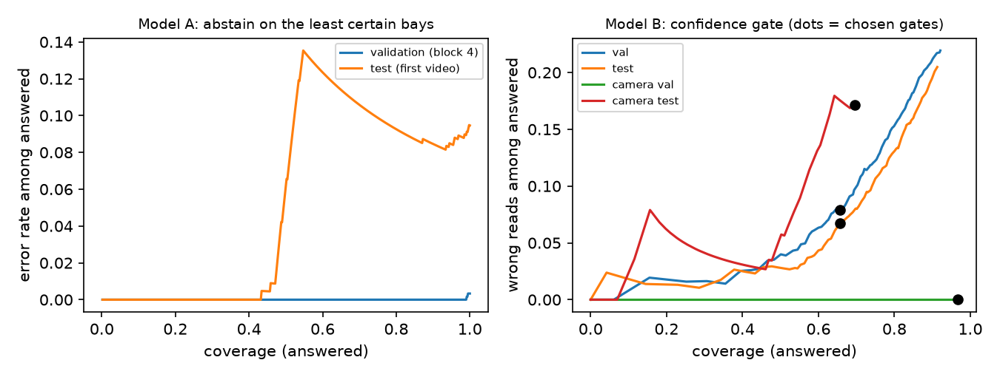

# Smart Parking: protecting two private bays with one camera

## 1. Venture and user

I have two allocated parking bays in Dubai that strangers sometimes take, mostly at night. Without this system, I notice a stranger’s car only when I walk down to my bays. I built a product that watches them with one fixed camera and says, for each car's stay, **AUTHORIZED**, **POTENTIALLY_UNAUTHORIZED** (alert) or
**NEEDS_REVIEW** (I must look, with a reason and an evidence frame). I manage guests with plain
commands ("allow car 12345 until 6 pm"); a change reaches the permit table only after I
confirm it. The commercial case is a cheap add-on for people with allocated bays: it replaces
patrols with a few notifications a night.

**Scope.** I delivered occupancy, plate identity (emirate, code, number), my commands, the
joined decision, a CLI and a demo app. Out of scope: towing or fines, other camera layouts than
two side-by-side bays, daytime operation at my site (I could not record it, see §8),
voice input (commands arrive as speech-to-text).

**Project change.** After the intermediate submission the earlier project could not continue; after our discussion, I replaced it with this one. There is therefore no proposal to measure against: the success criteria in §4.4 were fixed during this project, before the tests they judge (dates in `Memory.md`).

## 2. System design and parameter budget

```
frame ─> camera check (blocked / unfamiliar view / blurred?) ─yes─> NEEDS_REVIEW + reason
  │ no
  ├─> Model A (scratch CNN): each bay occupied? ─yes─> Model B (YOLO11n + rules): plate
  │                                                         │
my text ─> Model C (GLiNER + MiniLM, checked by SmolLM2) ─> proposal ─> I confirm
  │                                                         │
  └──────────── permit table + time (tabular) ─> per-stay decision (10 s, majority plate)
```

Three modalities interact in one decision: **images** (A, B), **text** (C) and **tabular** (the
permit table with end times). Five capabilities are connected: detect occupancy and confirm
arrivals, read the plate, parse and confirm commands, check permits in time, and escalate with
evidence.


| model                          | role                                       | training                                | parameters  |
| ------------------------------ | ------------------------------------------ | --------------------------------------- | ----------- |
| A OccupancyCNN (4 conv blocks) | is each bay occupied                       | from scratch, then adapted to my camera | 294,129     |
| B YOLO11n + reading rules      | plate box, each character, emirate type    | pretrained (COCO), fine-tuned           | 2,616,304   |
| C1 GLiNER small v2.1           | plate number and end time in a command     | pretrained, frozen                      | 152,648,704 |
| C2 all-MiniLM-L6-v2            | allow / remove / other by nearest examples | pretrained, frozen                      | 22,713,216  |
| C3 SmolLM2-135M-Instruct       | second opinion on action and number        | pretrained, frozen                      | 134,515,008 |


*Table 1. Counted from the loaded weights (`outputs/budget.md`). Every model is under 200M, the
scratch model is far under 50M, and the pretrained and fine-tuned models total 312M (limit 1B).*

**Why I chose these models.** Occupancy of a fixed crop is a small binary problem, so a 0.3M CNN trained
from scratch is enough (99.3% F1 on public validation) and runs in 7 ms. Plates need complete
identity, not a box: a detector that finds each character and the emirate type, assembled by
geometry rules, fit the available character-box labels; I did not run an end-to-end OCR comparison. Commands are short
and the cost of a wrong change is high, so Model C extracts pieces with frozen pretrained models
and leaves the decision to fixed, tested rules; it never generates free text and only copies
words from the command.

**Learned vs. deterministic.** Models perceive; rules decide. I added each rule after a
failure seen in development (`outputs/trust/failures.md`): duplicate character boxes merged
(one "1" read as "111"), Dubai plates need a code, a plate under 10% of the bay width belongs to
a car further back, a day said must appear in the time read, a stay needs 10 s of agreement,
and frames that do not look like the configured camera are not judged: the stay stays open and
the bay comes to me for review.

## 3. Data and splits


| data                            | use                                                               | split and size                                                                                                 |
| ------------------------------- | ----------------------------------------------------------------- | -------------------------------------------------------------------------------------------------------------- |
| CNRPark+EXT (public)            | train Model A                                                     | 40,000 train, 12,714 val, 23,589 test crops; one camera and one site held out entirely (2,902 and 7,089 crops) |
| AddingUAE (public, CC BY 4.0)   | fine-tune Model B                                                 | 7,000 car photos, 5,000/1,000/1,000, re-split so no plate identity or near-copy crosses splits                 |
| My night video 2 (43 min)       | adapt Model A; choose thresholds                                  | blocks 1-3: 1,604 bay crops (train); block 4: 600 (validation)                                                 |
| My night video 1 (10 min)       | cross-night check of Model A and the system (seen in development) | 486 bay crops, 243 frames, another night                                                                       |
| My night video 3 (24 min)       | final system test, sealed and run once                            | 719 frames, 1,142 bay crops; I checked the truth before any model saw it                                       |
| My 51 photos (102 bays)         | check on other car parks                                          | development checks; plate rules were informed by observed failures                                             |
| My commands (generated, seeded) | Model C                                                           | dev 60; frozen test 160 (33 in unseen wording); five extra dev-style sets; robustness 140                      |


*Table 2. Details and audits in `docs/data_card.md`.*

The public plate export leaked 118 plate identities across its random split, so it was re-split
by identity and image similarity. I split my videos **by time and night**, never by frame:
neighbouring frames are near-copies. Video truth was marked from frames every 2 s and checked by
me; I corrected three entries. Moving periods are not scored. All normalisation
statistics come from training data. Class imbalance is handled by balanced accuracy for model
choice on my data. **Fine-tuning items:** 6,000 plate images (train and validation)
plus, to be safe, the 2,204 night-2 crops used to adapt the scratch model: 8,204 of 10,000. Test
items are never learned from and are listed apart (`outputs/budget.md`).

## 4. Results

**Evaluation boundary.** Public test splits give the model results (Table 3). On my
camera, night 2 blocks 1-3 train and block 4 chooses every local setting. Three choices first
informed by night 1 (Model A's raw confidence, no feature-distance check, plate caching) were
made again on block 4 alone, under rules written down before running, and came out the same
(`outputs/trust/validation_choices.md`, `efficiency.md`). Night 1 was seen during development,
so its results are a cross-night check. The final test is night 3, recorded after the design was
frozen (by code and weight fingerprints in `Memory.md`, not by a commit); I checked its truth
before any model saw it, wrote down the main measure first, and ran the test
once (§4.4).

### 4.1 Baselines and training choices


|                                                                  | baseline                                                                                 | ours (test)                             |
| ---------------------------------------------------------------- | ---------------------------------------------------------------------------------------- | --------------------------------------- |
| A occupancy, public test F1 (test / unseen camera / unseen site) | HOG + logistic regression 0.946 / 0.965 / 0.854; texture threshold 0.855 / 0.862 / 0.830 | 0.993 / 0.988 / 0.929 (mean of 3 seeds) |
| B plate, public test full-plate exact match                      | YOLO11n from scratch: 0.0%                                                               | 72.8% (wrong reads 19.2%, 92% answered) |
| C commands, frozen test (exact / wrong changes proposed to me)   | fixed rule parser: 64% / 3 of 160                                                        | 50% / 1 of 160                          |


*Table 3. `outputs/occupancy/final_results.md`, `outputs/plates/final_results.md`,
`outputs/commands/final_test.md`.*

Training choices were made on validation only and logged (`experiments/`, TensorBoard and
per-epoch histories). For Model A, learning rate, augmentation, regularisation and input size
all landed within 0.4 percentage points of F1; the cheapest adequate setting (64 px) was kept. For Model B,
960 px images doubled exact match over 640 px (69.7% vs 34.8% on validation), fine-tuning the
whole network beat a frozen backbone (69.7% vs 3.8%), and 5,000 training images beat 2,500
(69.7% vs 57.6%). Three reading rules added after a night check lowered wrong reads from 27.5%
to 19.2% on the public test at the cost of answering 92% instead of 98%. For Model C, three
pretrained candidates were tried on dev only; GLiNER + MiniLM was the most accurate (73% test)
but proposed 15 wrong changes to me, so I added a second-model check and three
safety checks, buying safety with coverage (§7).

### 4.2 Adapting Model A to my camera

The public model never missed a parked car on night 1 but called **78 of 243**
empty-bay checks occupied (glare, wheel stops, people). Four adaptation options were trained on
night 2 and compared on block 4 under a rule committed to Git before training: the best balanced
accuracy that misses no more cars and keeps public validation F1 within 1 point.


| option (3-seed vote, block 4)        | balanced acc. | cars missed | empty→occupied | public val F1 |
| ------------------------------------ | ------------- | ----------- | -------------- | ------------- |
| public model                         | 0.910         | 0           | 41             | 0.994         |
| a. new threshold only                | 0.990         | 1           | 4              | 0.988         |
| **b. fine-tune last block (chosen)** | **0.996**     | 0           | 2              | 0.985         |
| c. full fine-tune, lr 1e-4 / 3e-4    | 0.991 / 1.000 | 0 / 0       | 4 / 0          | 0.992 / 0.984 |
| d. wider CNN (1.2M) from scratch     | 1.000         | 0           | 0              | 0.964         |


*Table 4. `outputs/occupancy/adaptation_val.md`. Options reaching 1.000 forgot the public data and
were rejected by the 1-point guard; the wider CNN peaked at its first epoch and then memorised
the two bays.*

On the sealed night 3, normal frames improved from 0.961 to **0.999** balanced accuracy and
empty bays called occupied fell from 84 to 1. Two costs: a car across both bays or over the
middle line was called empty in 147 of 258 checks under the seeds' majority vote used to choose
the option (the public model missed none; the product's own rule is costed in §5); and general
skill fell (public test F1 0.994 → 0.988, unseen public site 0.932 → 0.857)
(`outputs/occupancy/adaptation_test.md`). I use the adapted model for
my camera and the public model for any newly set-up camera.

### 4.3 Ablations: does each part earn its place?


| removed                            | right answers (102 bays, other car parks) | what breaks                         |
| ---------------------------------- | ----------------------------------------- | ----------------------------------- |
| nothing                            | 74%                                       | —                                   |
| Model A (every bay "occupied")     | 35%                                       | 66 needless reviews                 |
| Model B (no plate)                 | 49%                                       | no car can be identified            |
| commands (empty permit table)      | 66%                                       | 8 guests flagged                    |
| the time check (permits never end) | 69%                                       | **5 unauthorized cars let through** |
| Model C → fixed rule parser        | 74%                                       | nothing on my wording               |


*Table 5. `outputs/loop/ablation.md`. Each image, text and tabular part changes the answers.*

The honest negative result: on commands in my own wording, the rule parser was as good
as Model C (it got all 33 right with no questions, against Model C's 24 right and 9 questions),
because those templates are the ones the rules were written from. On new wording the rules put
three wrong changes proposed to me against Model C's one. Model C earns its place on safety under
new wording, not on accuracy.

### 4.4 The final test: the whole system on the sealed night 3

I recorded a 24-minute night alone, moving both cars through a checklist of events, and
typed three commands: the BMW always, the Tesla for the first 8 minutes, and one off-topic line.
Model C's proposals were accepted as proposed, so its mistakes would reach the bays.


| criterion (fixed before the test)                                   | result                                                                                                                   | status     |
| ------------------------------------------------------------------- | ------------------------------------------------------------------------------------------------------------------------ | ---------- |
| **main measure: stays of 30 s or more answered right at their end** | **5 of 9** (all 4 wrong are the two cars across both bays); the 22 s stay also right                                     | partly met |
| no false alert on an allowed car                                    | 0 of 455 frames; 0 stays seen with no car there                                                                          | met        |
| no unauthorized car let through                                     | never shown AUTHORIZED, but the Tesla centred on the middle line was shown EMPTY in both bays for its 96 s stay          | not met    |
| every normal stay answered right by its end                         | 6 of 6, including the permit running out, a crooked car, a person in front of a plate                                    | met        |
| a blocked view goes to a person                                     | 20 of 20 frames                                                                                                          | met        |
| Model A misses no parked car                                        | 5 of 475 car checks in normal stays; 95 of 192 for cars across both bays                                                 | partly met |
| Model C: 0 wrong changes                                            | 3 of 3 commands right on the test night (the off-topic line drew a question, not a refusal); 1 of 160 on the frozen test | partly met |
| few notifications                                                   | **20** in 24 minutes with two cars moving                                                                                | met        |
| near real time on a Mac                                             | about 20 ms per frame on average, 67 ms at p95 (camera check 5, A 7, B 57 per plate read); about 114 ms per command      | met        |


*Table 6. `outputs/final_test/night_3.md`, `outputs/loop/latency.md`. Per stay, 82% of scored bay
checks are right; normal slices 99%. On night 1 (seen, `video_night_1_stays.md`) the same design
gave 83% per stay and 28 notifications in 10 minutes. Timings vary by a few percent between runs.*

After the test, a review found that the folder command answered a command typed during a video
only after the whole video; it now applies from the next frame. The test was not affected: its
runner reads the commands first, and the only command typed during the video was off-topic.

The BMW across both bays went to review in both bays, which is safe. The Tesla centred on the
middle line was worse: each bay held about half of it, Model A called both empty, and a car whose
permit had ended was missed. This is the known weakness from development, and the test shows it
can fail unsafely. It was not fixed after the test, because fixing it on the test would be tuning
on it.

## 5. Trust and safety

**Calibration.** For Model B, a read's confidence (its weakest box) was under-confident: reads
at 0.75 were right 95% of the time. Platt scaling fitted on validation cut test ECE from 0.139 to
**0.036** (10 equal bins, counts in `outputs/trust/calibration.md`). For Model A, Platt scaling
fitted on one part of block 4 and checked on the other was worse than the raw mean probability
(held-out ECE 0.023 vs 0.011), so the product keeps the raw probability. The sealed night 3
agrees (0.052 raw vs 0.146 scaled): scaling pushes half-car crops to "surely empty".


*Figure 1. Test reliability; bars are observed rates, numbers are bin counts.*

**Costs and thresholds.** Costs are minutes of my attention: a false alert 5 (a walk
down, maybe a confronted guest), a missed unauthorized car 10 (the bay is lost for hours), a
review 1 (a glance), with 70% of cars allowed. Model A's threshold (0.86) and Model B's minimum
calibrated confidence were chosen on validation by expected cost and stored in
`configs/default.yaml`. A plate gate first tuned on public photos (0.7) sent 30% of my
bays to a person, because correct reads on this camera carry lower confidence; re-chosen on the
my validation block it became 0.15, and on the test night it costs 0.39 per plate against
0.63 for the public gate. On the test night the adapted Model A costs more than the public model,
even car by car (0.26 vs 0.07 per bay check), because of the cars across both bays, one of them
truly missed; on normal frames it costs 0.007 against 0.040. Model A's threshold stayed at 0.86–0.88 under every
cost assumption tried; the public-data plate gate moved from 0.1 to 0.85, so gates should be
re-chosen if my costs differ (`outputs/trust/costs.md`).


*Figure 2. Abstaining on the least certain cases lowers the error rate among answers.*

**Unfamiliar inputs and escalation.** Tiers run cheapest first: a fixed check for a blocked
camera; a comparison of the background (outside the bays) with a set-up snapshot; a sharpness
check; then the models; and finally me. With cut-offs from block 4 (1% of normal frames),
the product asks a person on 1% of normal night-3 frames, 94% of other car parks and 100% of
blurred, covered or noise frames, but only 24% of over-exposed frames and **3% of frames with a
simulated shifted and zoomed camera** (98% on night 1), so a knocked camera is not reliably
caught (`outputs/trust/ood.md`). A feature-distance check on Model A would catch about 13% of corrupted
block-4 frames the other checks miss, but its held-out false-alarm rate on block 4 (2.6%) fails
the 2% rule set in advance, so it is not used.

**Robustness.** On night-1 frames with the camera check, Model A answers until the scene is 80% darker (balanced
accuracy 0.87) and then abstains; blur of 2 px or more and strong glare are sent to a person;
noise and JPEG compression barely move it. Model B is the weak point: blur of 4 px leaves 3% of
plates readable and heavy noise causes wrong reads (37% at noise sd 40), which the camera check
does not catch (`outputs/trust/robustness_images.md`). Command robustness: typos make Model C ask
more; one trick still produces a wrong proposal for my review.


*Figure 3. Increasing stress: abstention, Model A accuracy and Model B wrong reads.*

**Monitoring.** Rolling one-minute windows track brightness, view similarity, camera-check
failures, Model A's unsure share, the review rate, latency and my rejections of Model
C. Replaying night 1 with a dimming street light from 4:00 and a knocked camera at 7:00,
the monitor flagged the light after about 60 s and the camera after 96 s (the knocked view sat
just above the cut-off until a car drove in). Before the injected problems it fired once, a
false alarm while a car stood across both bays and then manoeuvred out.
Each alert names the maintainer's action (`outputs/trust/monitoring.md`).


*Figure 4. The replayed night; red lines are injected problems.*

## 6. Efficiency and generalization

On the Mac (Apple GPU), with all models loaded once (5 s, 2.7 GB peak memory), a frame takes
about 20 ms on average and 67 ms at p95 end to end, and a command about 114 ms (p95 377 ms)
(`outputs/loop/latency.md`). **Efficiency study:** the product re-read the same parked car every
2 s. Chosen on block 4: stopping Model B once a stay's plate has been read the same way three
times cut model time to **13%** (about 2,000 → 270 ms per minute of video) with identical answers (4 of 6
stay ends, 96% per stay, same notifications); sampling every 4 s as well cut it to 7%. On night 1,
caching cut model time to 33% and per-stay answers went from 79% to 83%
(`outputs/trust/efficiency.md`).

**Generalization gaps.** Model A: public test 0.993 → unseen site 0.929 F1; adapted, 0.999
balanced accuracy on normal frames of the sealed night but other car parks 0.75. Model B: 72.8%
exact on public photos; on the sealed night 441 of 475 checks in normal stays read exactly, but
none for a car across both bays.
Model C: 58% exact on the test slice using dev-style wording, 0% on unseen wording;
one unseen command still produced a wrong proposal. Abstention reduces risk but does not
eliminate wrong answers.

## 7. Explainability and failure analysis


| probe (hypothesis)                                                          | result                                                                                                       | what it means                                                            |
| --------------------------------------------------------------------------- | ------------------------------------------------------------------------------------------------------------ | ------------------------------------------------------------------------ |
| A1: Model A looks at the car, not the row behind                            | greying the bottom third drops "occupied" from 100% to 4%; top third: no change                              | it relies on bumper, plate and wheels                                    |
| A2: glare looks like a car to the public model only                         | empty bays called occupied at glare 0.6: public 65%, adapted 0%; at 0.9: 100% and 98%                        | adaptation removed moderate glare sensitivity, not strong glare          |
| A3: half a car is called empty                                              | greying the left half: 48% still occupied; the right half: 99%                                               | partly supported: without the left of the crop, half the cars look empty |
| B1: a hidden last character makes the reader ask                            | 58% silent misreads, 2% ask                                                                                  | a real risk; see below                                                   |
| B2: a hidden code side makes it ask                                         | 46% ask, 50% misread                                                                                         | partly true                                                              |
| C: minimal pairs (verb, negation, spoken digits, bay, AM/PM, a dropped day) | each behaves as designed; one written-digit negation is unsupported; the frozen spoken-digit negation failed | the rules, not the models, decide                                        |
| S: the same car with one input changed                                      | permit → AUTHORIZED; no permit → alert; one digit misread → alert; unclear plate → review                    | the decision truly uses text and table                                   |


*Table 7. `outputs/trust/probes.md`; Model A probes on the sealed night 3.*

**Failures, counted.** On the sealed night 3, 225 of 1,162 scored bay checks were wrong frame by
frame: 97 (43%) a bay of a car across both bays with no plate in view, 95 (42%) the bay holding
half of such a car called empty, 13 plates misread, 13 plates too small and sent to review, 5
parked cars missed in normal stays, 1 car with no plate found and 1 empty bay called occupied. For plate seed 42 on the public test, 187 of 1,000 were misread and 87 sent to
review (Table 3 averages three seeds). Model C's 160 test commands produced 58 needless questions (32 from new wording), 1
wrong change, 11 wrong reasons and 7 missed "unsupported" requests (`outputs/trust/failures.md`).

**Fixes linked to failures (before → after).** Plate rules: wrong reads 27.5% → 19.2%. Model A
adaptation: false "occupied" 78 → 3 of 243 on night 1, 84 → 1 on night 3. Per-stay decisions
(night 1, public model): false alerts 4 → 0, notifications 78 → 29. The day-word check for Model C: the one wrong time proposal in the full loop became a
question. The contrast-normalised sharpness check flags 2.5% of frames at brightness ×0.6;
the earlier comparison is not preserved. The plate gate was re-chosen on validation; a matched before/after system comparison is
not preserved.

**Remaining failure modes.** The car across both bays (on the test it caused the one missed car); plates with a hidden character read as a
shorter number (the per-stay majority helps only when the occlusion is brief; a rule that checks
how much of the plate width the characters span is the next fix); over-exposure; Model C's
questions on new wording; and Model A's lost generality.

## 8. Insights, limitations and risks

**What the evidence supports.** (1) Safety comes from structure more than accuracy: per-stay
decisions, confirmation before any permit change and refusing unfamiliar views produced zero
false accusations while the models themselves still erred. (2) The expensive mistakes are
rare geometric cases (a car across two bays, the only missed car on the test), not average
accuracy; a deployment should draw the
bay boxes so a straddling car is caught by both, or treat "one car, two bays" as its own event.
(3) Specialising the occupancy model to one camera removes false "occupied" calls (84 → 1 on
the test) but made the straddling car worse and creates a maintenance duty: any new camera needs a snapshot, boxes and a short adaptation. (4)
Operating points did not transfer between datasets or nights (the public plate gate; Platt
scaling and the feature-distance check fitted on one night); every operating point must be
chosen on validation data from the deployment camera.

**Human review policy.** With the chosen costs I saw 20 notifications in a busy
24-minute test night with two cars moving, including every moment the camera check could not
judge, far fewer on a quiet night; each comes with an evidence frame
and a reason. An alert is never an accusation: I check before acting.

**Limitations.** The final test is one 24-minute night with my two cars, staged by me from a
known checklist, and night 1 was seen during development; there is no daytime
test at my site (it is too crowded by day to fix a camera); command tests use generated
sentences in my style; the instructor's unseen inputs will differ in camera and
lighting, so the product will often ask rather than answer (by design).

**Risks and ethics.** The people harmed by errors are a guest wrongly flagged (mitigated: I
check the evidence before acting) and me when a stranger is missed
(mitigated: unclear cases go to review rather than to "authorized"). The system stores plates
and faces; I consented to publishing my captured data, but a real deployment must keep records
briefly, show signage and serve only the permitted bays. Feedback (accepted, rejected and
corrected commands; decisions I mark wrong) is stored as structured records and would
be used to re-choose thresholds and, with enough frames, to re-adapt Model A.