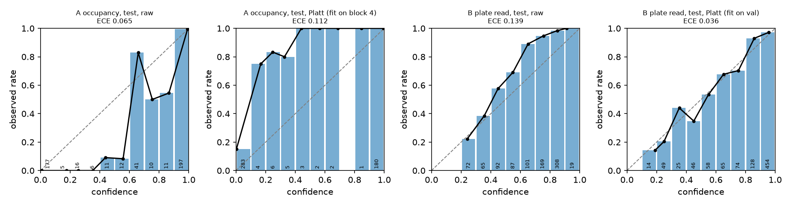
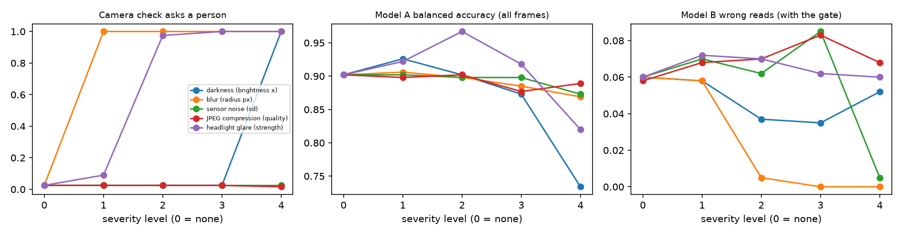
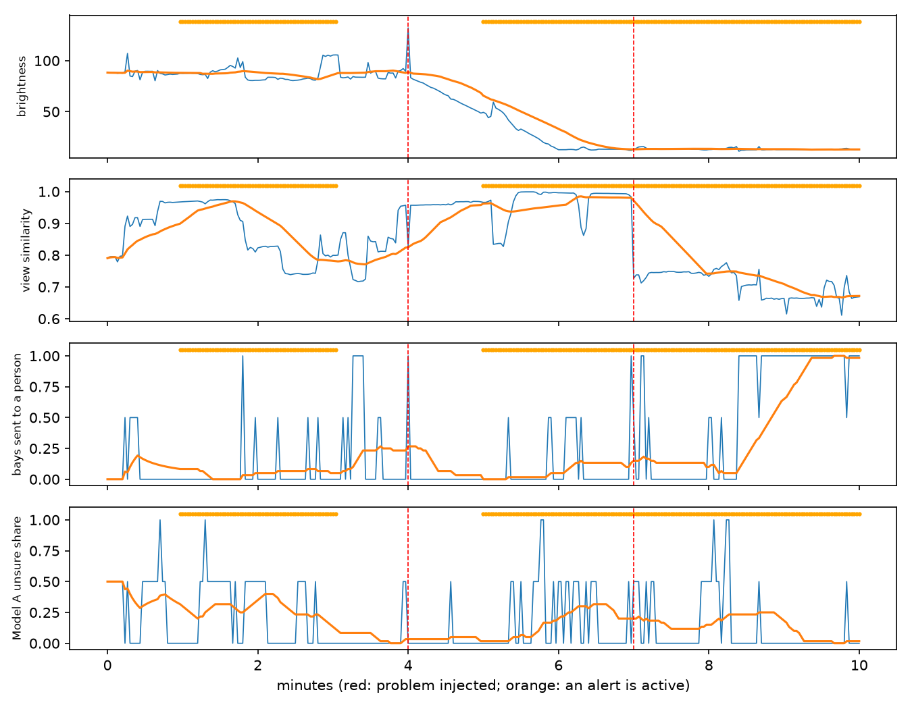

# Smart Parking: protecting two private bays with one camera

Every number below is produced by a `just` recipe (`just evaluate` regenerates them all); the
file behind each table is named in its caption. Decisions and dates are in `Memory.md`.

## 1. Venture and user

A homeowner in Dubai has two allocated parking bays that strangers often take, mostly at night.
Today the owner notices only by walking down. The product watches the two bays with one fixed
camera and says, for each car's stay, **AUTHORIZED**, **POTENTIALLY_UNAUTHORIZED** (alert) or
**NEEDS_REVIEW** (a person must look, with a reason and an evidence frame). The owner manages
guests in plain words ("allow car 12345 until 6 pm"); a change reaches the permit table only
after the owner confirms it. The commercial case is a cheap add-on for villa and building owners
with allocated bays: it replaces patrols by a few notifications a night.

**Scope.** Delivered: occupancy, plate identity (emirate, code, number), owner commands, the
joined decision, a CLI and a demo app. Out of scope: towing or fines, other camera layouts than
two side-by-side bays, daytime operation at the owner's site (it could not be recorded, see §8),
voice input (commands arrive as speech-to-text).

**Project change.** After the intermediate submission the earlier project could not continue;
with the instructor's agreement it was replaced by this one. There is therefore no proposal to
measure against: the success criteria in §4.4 were fixed during this project, before the tests
they judge (dates in `Memory.md`).

## 2. System design and parameter budget

```
frame ─> camera check (blocked / unfamiliar view / blurred?) ─yes─> NEEDS_REVIEW + reason
  │ no
  ├─> Model A (scratch CNN): each bay occupied? ─yes─> Model B (YOLO11n + rules): plate
  │                                                         │
owner text ─> Model C (GLiNER + MiniLM, checked by SmolLM2) ─> proposal ─> owner confirms
  │                                                         │
  └──────────── permit table + time (tabular) ─> per-stay decision (10 s, majority plate)
```

Three modalities interact in one decision: **images** (A, B), **text** (C) and **tabular** (the
permit table with end times). Five capabilities are connected: detect occupancy and confirm
arrivals, read the plate, parse and confirm commands, check permits in time, and escalate with
evidence.

| model | role | training | parameters |
|---|---|---|---|
| A OccupancyCNN (4 conv blocks) | is each bay occupied | from scratch, then adapted to the owner's camera | 294,129 |
| B YOLO11n + reading rules | plate box, each character, emirate type | pretrained (COCO), fine-tuned | 2,616,304 |
| C1 GLiNER small v2.1 | plate number and end time in a command | pretrained, frozen | 152,648,704 |
| C2 all-MiniLM-L6-v2 | allow / remove / other by nearest examples | pretrained, frozen | 22,713,216 |
| C3 SmolLM2-135M-Instruct | second opinion on action and number | pretrained, frozen | 134,515,008 |

*Table 1. Counted from the loaded weights (`outputs/budget.md`). Every model is under 200M, the
scratch model is far under 50M, and the pretrained and fine-tuned models total 312M (limit 1B).*

**Why these models.** Occupancy of a fixed crop is a small binary problem, so a 0.3M CNN trained
from scratch is enough (99.3% F1 on public validation) and runs in 6 ms. Plates need complete
identity, not a box: a detector that finds each character and the emirate type, assembled by
geometry rules, beat any end-to-end reader we could train on 5,000 images. Commands are short
and the cost of a wrong change is high, so Model C extracts pieces with frozen pretrained models
and leaves the decision to fixed, tested rules; it never generates free text and only copies
words from the command.

**Learned vs. deterministic.** Models perceive; rules decide. Each rule was added after a
failure seen in development (`outputs/trust/failures.md`): duplicate character boxes merged
(one "1" read as "111"), Dubai plates need a code, a plate under 10% of the bay width belongs to
a car further back, a day said must appear in the time read, a stay needs 10 s of agreement,
and frames that do not look like the configured camera are not judged.

## 3. Data and splits

| data | use | split and size |
|---|---|---|
| CNRPark+EXT (public) | train Model A | 40,000 train, 12,714 val, 23,589 test crops; one camera and one site held out entirely (2,902 and 7,089 crops) |
| AddingUAE (public, CC BY 4.0) | fine-tune Model B | 7,000 car photos, 5,000/1,000/1,000, re-split so no plate identity or near-copy crosses splits |
| Owner, night video 2 (43 min) | adapt Model A; choose thresholds | blocks 1-3: 1,604 bay crops (train); block 4: 600 (validation) |
| Owner, night video 1 (10 min) | final test of Model A and the system | 486 bay crops, 243 frames, another night |
| Owner, 51 photos (102 bays) | check on other car parks | never used for training or choices |
| Owner commands (generated, seeded) | Model C | dev 60; frozen test 160 (33 in unseen wording); five extra dev-style sets; robustness 140 |

*Table 2. Details and audits in `docs/data_card.md`.*

The public plate export leaked 118 plate identities across its random split, so it was re-split
by identity and image similarity. Owner videos were split **by time and night**, never by frame:
neighbouring frames are near-copies. Video truth was marked from frames every 2 s and checked by
the owner, who corrected three entries. Moving periods are not scored. All normalisation
statistics come from training data. Class imbalance is handled by balanced accuracy for model
choice on the owner's data. **Fine-tuning items:** 7,000 plate images; the 2,690 local crops
belong to the scratch model and lie outside the cap, but even counted the total is 9,690 of
10,000 (`outputs/budget.md`).

## 4. Results

### 4.1 Baselines and training choices

| | baseline | ours (test) |
|---|---|---|
| A occupancy, public test F1 (test / unseen camera / unseen site) | HOG + logistic regression 0.946 / 0.965 / 0.854; texture threshold 0.855 / 0.862 / 0.830 | 0.993 / 0.988 / 0.929 (mean of 3 seeds) |
| B plate, public test full-plate exact match | YOLO11n from scratch: 0.0% | 72.8% (wrong reads 19.2%, 92% answered) |
| C commands, frozen test (exact / wrong changes put to the owner) | fixed rule parser: 64% / 3 of 160 | 50% / 1 of 160 |

*Table 3. `outputs/occupancy/final_results.md`, `outputs/plates/final_results.md`,
`outputs/commands/final_test.md`.*

Training choices were made on validation only and logged (`experiments/`, TensorBoard and
per-epoch histories). For Model A, learning rate, augmentation, regularisation and input size
all landed within 0.3 points of F1; the cheapest adequate setting (64 px) was kept. For Model B,
960 px images doubled exact match over 640 px (69.7% vs 34.8% on validation), fine-tuning the
whole network beat a frozen backbone (69.7% vs 3.8%), and 5,000 training images beat 2,500
(69.7% vs 57.6%). Three reading rules added after a night check lowered wrong reads from 27.5%
to 19.2% on the public test at the cost of answering 92% instead of 98%. For Model C, three
pretrained candidates were tried on dev only; GLiNER + MiniLM was the most accurate (73% test)
but put 15 wrong changes to the owner, so the chosen design adds a second-model check and three
safety checks, buying safety with coverage (§7).

### 4.2 Adapting Model A to the owner's camera

The public model never missed a parked car on the owner's night video but called **78 of 243**
empty-bay checks occupied (glare, wheel stops, people). Four adaptation options were trained on
night 2 and compared on block 4 under a rule committed to Git before training: the best balanced
accuracy that misses no more cars and keeps public validation F1 within 1 point.

| option (3-seed vote, block 4) | balanced acc. | cars missed | empty→occupied | public val F1 |
|---|---|---|---|---|
| public model | 0.910 | 0 | 41 | 0.994 |
| a. new threshold only | 0.990 | 1 | 4 | 0.988 |
| **b. fine-tune last block (chosen)** | **0.996** | 0 | 2 | 0.985 |
| c. full fine-tune, lr 1e-4 / 3e-4 | 0.991 / 1.000 | 0 / 0 | 4 / 0 | 0.992 / 0.984 |
| d. wider CNN (1.2M) from scratch | 1.000 | 0 | 0 | 0.964 |

*Table 4. `outputs/occupancy/adaptation_val.md`. Options reaching 1.000 forgot the public data and
were rejected by the 1-point guard; the wider CNN peaked at its first epoch and then memorised
the two bays.*

On the test night (one run), normal frames improved from 0.84 to **0.996** balanced accuracy
(empty called occupied 78 → 2, cars missed 0 → 0). Two costs: when a car stood across both
bays, the bay holding half of it was called empty (43–50 checks); and general skill fell (public
test F1 0.994 → 0.988, unseen public site 0.932 → 0.857). The product uses the adapted model for
the owner's camera and the public model for any newly set-up camera.

### 4.3 Ablations: does each part earn its place?

| removed | right answers (102 bays, other car parks) | what breaks |
|---|---|---|
| nothing | 74% | — |
| Model A (every bay "occupied") | 35% | 66 needless reviews |
| Model B (no plate) | 49% | no car can be identified |
| commands (empty permit table) | 66% | 8 guests flagged |
| the time check (permits never end) | 69% | **5 unauthorized cars let through** |
| Model C → fixed rule parser | 74% | nothing on this owner's wording |

*Table 5. `outputs/loop/ablation.md`. Each image, text and tabular part changes the answers.*

The honest negative result: on commands in the owner's own wording, the rule parser was as good
as Model C (it got all 33 right with no questions, against Model C's 24 right and 9 questions),
because those templates are the ones the rules were written from. On new wording the rules put
three wrong changes to the owner against Model C's one. Model C earns its place on safety under
new wording, not on accuracy.

### 4.4 The full system on the test night, against the project's criteria

| criterion (fixed during the project) | result | status |
|---|---|---|
| no false alert on an allowed car | 0 per stay on the test night (1 single-frame alert, removed by the per-stay rule); 0 on 102 other-car-park bays | met |
| no unauthorized car let through as AUTHORIZED | 0 (test night as visitors; 102 bays) | met |
| every normal stay answered right by its end | 4 of 4 | met |
| Model A misses no parked car | 0 in normal frames; the half-car bay of a car across both bays called empty | partly met |
| Model C: 0 wrong changes on dev; low on test | 0 on dev; 1 of 160 on test | partly met |
| few notifications | 78 → **13** in 10 minutes (one decision per stay) | met |
| near real time on a Mac | 65-120 ms per frame (camera check 5, A 6, B 54 per occupied bay); 118 ms per command | met |

*Table 6. `outputs/loop/video_night_1.md`, `video_night_1_stays.md`, `full_loop.md`,
`outputs/loop/latency.md`. Per stay, 85% of scored bay checks are right; most remaining errors are
the car across both bays.*

## 5. Trust and safety

**Calibration.** For Model B, a read's confidence (its weakest box) was under-confident: reads
at 0.75 were right 95% of the time. Platt scaling fitted on validation cut test ECE from 0.139 to
**0.036** (10 equal bins, counts in `outputs/trust/calibration.md`). Model A's raw mean
probability was already fair on the other night (ECE 0.065); scaling fitted on block 4 made it
worse (0.112), pushing half-car crops to "surely empty". We kept A's raw probability, a choice
informed by the test and reported as such: one night cannot calibrate another.


*Figure 1. Test reliability; bars are observed rates, numbers are bin counts.*

**Costs and thresholds.** Costs are minutes of the owner's attention: a false alert 5 (a walk
down, maybe a confronted guest), a missed unauthorized car 10 (the bay is lost for hours), a
review 1 (a glance), with 70% of cars allowed. Model A's threshold (0.86) and Model B's minimum
calibrated confidence were chosen on validation by expected cost and stored in
`configs/default.yaml`. A plate gate first tuned on public photos (0.7) sent 30% of the owner's
bays to a person, because correct reads on this camera carry lower confidence; re-chosen on the
owner's validation block it became 0.15. Car by car, the adapted Model A costs 0.017 per bay
check against 0.16 for the public model; counted bay by bay it costs more (0.31 vs 0.16), because
each half-car bay is charged as a missed car. Model A's threshold stayed at 0.86–0.88 under every
cost assumption tried; the public-data plate gate moved from 0.1 to 0.85, so gates should be
re-chosen if the owner's costs differ (`outputs/trust/costs.md`).


*Figure 2. Abstaining on the least certain cases lowers the error rate among answers.*

**Unfamiliar inputs and escalation.** Tiers run cheapest first: a fixed check for a blocked
camera; a comparison of the background (outside the bays) with a set-up snapshot; a sharpness
check; then the models; and finally the owner. With cut-offs from block 4 (1% of normal frames),
the product asks a person on 5% of normal test frames and on 94% of other car parks, 98% of a
moved camera and 100% of blurred, covered or noise frames, but only 36% of over-exposed frames
(`outputs/trust/ood.md`). A feature-distance check on Model A flagged 13% of normal frames on the
other night and is not used.

**Robustness.** With the camera check, Model A answers until the scene is 80% darker (balanced
accuracy 0.87) and then abstains; blur of 2 px or more and strong glare are sent to a person;
noise and JPEG compression barely move it. Model B is the weak point: blur of 4 px leaves 3% of
plates readable and heavy noise causes wrong reads (37% at noise sd 40), which the camera check
does not catch (`outputs/trust/robustness_images.md`). Command robustness: typos make Model C ask
more; missing pieces, ambiguity, off-topic and tricks are handled safely.


*Figure 3. Increasing stress: abstention, Model A accuracy and Model B wrong reads.*

**Monitoring.** Rolling one-minute windows track brightness, view similarity, camera-check
failures, Model A's unsure share, the review rate, latency and the owner's rejections of Model
C. Replaying the test night with a dimming street light from 4:00 and a knocked camera at 7:00,
the monitor flagged the light after about 60 s and the camera after 96 s (the knocked view sat
just above the cut-off until a car drove in). It also fired twice before any problem: once for a
car parked across both bays for minutes (useful) and once while cars manoeuvred (a false alarm).
Each alert names the maintainer's action (`outputs/trust/monitoring.md`).


*Figure 4. The replayed night; red lines are injected problems.*

## 6. Efficiency and generalization

On the Mac (Apple GPU) a frame costs about 65 ms with one bay occupied and 120 ms with both, a
command 118 ms (p95 394 ms); loading takes 10 s and 2.2 GB. **Efficiency study:** the product re-read the same parked
car every 2 s. Stopping Model B once a stay's plate has been read the same way three times cut
model time to **38%** (1,454 → 557 ms per minute of video) with per-stay accuracy unchanged
(81% → 82%) and fewer notifications; sampling every 4 s as well cut it to 22% with confirmation
1 s later. Caching is now in the product (`outputs/trust/efficiency.md`).

**Generalization gaps.** Model A: public test 0.993 → unseen site 0.929 F1; adapted, the owner's
other night 0.996 balanced accuracy but other car parks 0.75. Model B: 72.8% exact on public
photos, fewer on the owner's camera (89 of 119 normal bays read exactly at the frame level).
Model C: 58% exact on dev-style wording, 0% on unseen wording (it asks instead). The system is
safest exactly where it is least accurate: unfamiliar inputs become questions, not guesses.

## 7. Explainability and failure analysis

| probe (hypothesis) | result | what it means |
|---|---|---|
| A1: Model A looks at the car, not the row behind | greying the bottom third drops "occupied" from 100% to 10%; top third: no change | it relies on bumper, plate and wheels |
| A2: glare looks like a car to the public model only | empty bays called occupied at glare 0.6: public 63%, adapted 16% | adaptation removed most glare sensitivity |
| A3: half a car is called empty | greying either half: still 100% occupied | rejected: the across-both-bays failure comes from where the car sits in the box |
| B1: a hidden last character makes the reader ask | 58% silent misreads, 2% ask | a real risk; see below |
| B2: a hidden code side makes it ask | 46% ask, 50% misread | partly true |
| C: minimal pairs (verb, negation, spoken digits, bay, AM/PM, a dropped day) | each behaves as designed; "don't allow ... anymore" is now unsupported, not a change | the rules, not the models, decide |
| S: the same car with one input changed | permit → AUTHORIZED; no permit → alert; one digit misread → alert; unclear plate → review | the decision truly uses text and table |

*Table 7. `outputs/trust/probes.md`.*

**Failures, counted.** On the test night, 87 of 486 scored bay checks were wrong: 43 (49%) the
half-car bay called empty, 25 (29%) the other bay of that car with no plate in view, 10 (11%)
frames the camera check refused, 6 (7%) plates sent to review for a missing code or emirate, and
3 empty bays called occupied. On the public plate test, 187 of 1,000 were misread and 87 sent to
review. Model C's 160 test commands produced 58 needless questions (32 from new wording), 1
wrong change, 11 wrong reasons and 7 missed "unsupported" requests (`outputs/trust/failures.md`).

**Fixes linked to failures (before → after).** Plate rules: wrong reads 27.5% → 19.2%. Model A
adaptation: 78 → 2 false "occupied". Per-stay decisions: false alerts 4 → 0, notifications 78 →
13. The day-word check for Model C: the one wrong time proposal in the full loop became a
question. A brightness-independent sharpness check: frames flagged at brightness ×0.6 fell from
100% to 2.5%. The plate gate re-chosen on the owner's camera: system answers 67% → 82% right.

**Remaining failure modes.** The car across both bays; plates with a hidden character read as a
shorter number (the per-stay majority helps only when the occlusion is brief; a rule that checks
how much of the plate width the characters span is the next fix); over-exposure; Model C's
questions on new wording; and Model A's lost generality.

## 8. Insights, limitations and risks

**What the evidence supports.** (1) Safety comes from structure more than accuracy: per-stay
decisions, confirmation before any permit change and refusing unfamiliar views produced zero
false accusations while the models themselves still erred. (2) The expensive mistakes are
rare geometric cases (a car across two bays), not average accuracy; a deployment should draw the
bay boxes so a straddling car is caught by both, or treat "one car, two bays" as its own event.
(3) Specialising the occupancy model to one camera is worth it (false "occupied" 78 → 2) but
creates a maintenance duty: any new camera needs a snapshot, boxes and a short adaptation. (4)
Thresholds tuned on public data did not transfer (the plate gate, Platt scaling for Model A,
the feature-distance OOD check); every operating point must be chosen on the deployment camera.

**Human review policy.** With the chosen costs the owner sees about 13 notifications in a busy
10 minutes with two cars moving, far fewer on a quiet night; each comes with an evidence frame
and a reason. An alert is never an accusation: the owner checks before acting.

**Limitations.** The test is one 10-minute night with the owner's two cars; there is no daytime
test at the site (it is too crowded by day to fix a camera); command tests use generated
sentences in the owner's style; the instructor's unseen inputs will differ in camera and
lighting, so the product will often ask rather than answer (by design).

**Risks and ethics.** The people harmed by errors are a guest wrongly flagged (mitigated: no
action without the owner, alerts carry evidence) and the owner when a stranger is missed
(mitigated: unclear cases go to review rather than to "authorized"). The system stores plates
and faces; the owner consented to publishing this data, but a real deployment must keep records
briefly, show signage and serve only the owner's two bays. Feedback (accepted, rejected and
corrected commands; decisions the owner marks wrong) is stored as structured records and would
be used to re-choose thresholds and, with enough frames, to re-adapt Model A.
