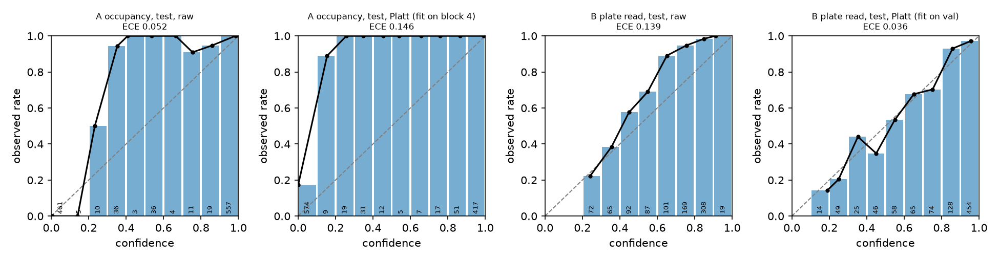

# Calibration (test split)

Model A: P(occupied) = the mean probability of the three deployed seeds, per bay crop.
Model B: the plate read's confidence (the lowest box confidence in the read) against whether
an answered read is exactly right. Model C gives no single confidence: it proposes a change only
when its checks agree, so its trust is measured by coverage and dangerous answers instead
(outputs/commands/final_test.md).

Binning: 10 equal-width bins of the confidence; each bin shows its mean confidence, its observed
rate and its count. ECE = the count-weighted mean gap between them. Calibration is improved with
Platt scaling (a logistic fit on the logit of the confidence), fitted on validation only
(block 4 for Model A, the public plate validation split for Model B), then shown on test.
The fitted parameters are saved to outputs/trust/calibration.json and used in the product.

| model | split | items | ECE before | ECE after |
|---|---|---|---|---|
| A occupancy | validation (block 4) | 600 | 0.0101 | 0.0039 |
| A occupancy | test (night video 3) | 1142 | 0.0521 | 0.1457 |
| B plate read | validation (public) | 921 | 0.1229 | 0.0299 |
| B plate read | test (public) | 913 | 0.139 | 0.0356 |

## What this says

- **Model B is under-confident:** its reads are right more often than its confidence says (bins below). Platt scaling fitted on validation fixes this on test, so the product shows Model B's calibrated confidence.
- **Model A keeps its raw probability.** The choice was made on block 4 alone: with each of two folds of block 4 held out in turn, Platt scaling had a higher calibration error than the raw probability (`validation_choices.md`). The test night only reports how both behave; nothing was chosen on it.

## Bins (test)

### A raw (test)

| bin | count | mean confidence | observed rate |
|---|---|---|---|
| 0.0-0.1 | 461 | 0.006 | 0.0 |
| 0.1-0.2 | 5 | 0.141 | 0.0 |
| 0.2-0.3 | 10 | 0.233 | 0.5 |
| 0.3-0.4 | 36 | 0.353 | 0.944 |
| 0.4-0.5 | 3 | 0.409 | 1.0 |
| 0.5-0.6 | 36 | 0.536 | 1.0 |
| 0.6-0.7 | 4 | 0.665 | 1.0 |
| 0.7-0.8 | 11 | 0.755 | 0.909 |
| 0.8-0.9 | 19 | 0.859 | 0.947 |
| 0.9-1.0 | 557 | 0.984 | 1.0 |

### A Platt (test)

| bin | count | mean confidence | observed rate |
|---|---|---|---|
| 0.0-0.1 | 574 | 0.001 | 0.174 |
| 0.1-0.2 | 9 | 0.155 | 0.889 |
| 0.2-0.3 | 19 | 0.258 | 1.0 |
| 0.3-0.4 | 31 | 0.349 | 1.0 |
| 0.4-0.5 | 12 | 0.456 | 1.0 |
| 0.5-0.6 | 5 | 0.54 | 1.0 |
| 0.6-0.7 | 7 | 0.657 | 1.0 |
| 0.7-0.8 | 17 | 0.759 | 1.0 |
| 0.8-0.9 | 51 | 0.865 | 1.0 |
| 0.9-1.0 | 417 | 0.99 | 1.0 |

### B raw (test)

| bin | count | mean confidence | observed rate |
|---|---|---|---|
| 0.0-0.1 | 0 |  |  |
| 0.1-0.2 | 0 |  |  |
| 0.2-0.3 | 72 | 0.241 | 0.222 |
| 0.3-0.4 | 65 | 0.356 | 0.385 |
| 0.4-0.5 | 92 | 0.449 | 0.576 |
| 0.5-0.6 | 87 | 0.549 | 0.69 |
| 0.6-0.7 | 101 | 0.652 | 0.891 |
| 0.7-0.8 | 169 | 0.755 | 0.947 |
| 0.8-0.9 | 308 | 0.849 | 0.984 |
| 0.9-1.0 | 19 | 0.911 | 1.0 |

### B Platt (test)

| bin | count | mean confidence | observed rate |
|---|---|---|---|
| 0.0-0.1 | 0 |  |  |
| 0.1-0.2 | 14 | 0.19 | 0.143 |
| 0.2-0.3 | 49 | 0.25 | 0.204 |
| 0.3-0.4 | 25 | 0.353 | 0.44 |
| 0.4-0.5 | 46 | 0.451 | 0.348 |
| 0.5-0.6 | 58 | 0.55 | 0.534 |
| 0.6-0.7 | 65 | 0.652 | 0.677 |
| 0.7-0.8 | 74 | 0.752 | 0.703 |
| 0.8-0.9 | 128 | 0.859 | 0.93 |
| 0.9-1.0 | 454 | 0.955 | 0.971 |
