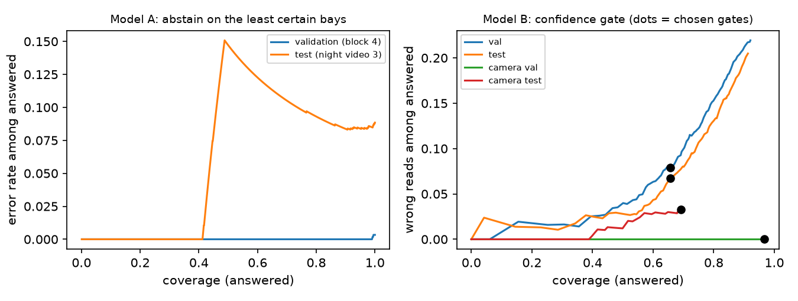

# Error costs, thresholds and risk-coverage

Costs are in "minutes of the owner's attention" (assumptions, see the report):
- a false alert (an allowed car or an empty bay flagged as potentially unauthorized): 5. The
  owner walks down to check and may confront a guest;
- an unauthorized car missed: 10. Someone takes the owner's bay for hours;
- a request for a person to look (NEEDS_REVIEW): 1. A glance at the evidence frame;
- p_authorized = 0.7: the share of cars in the owner's bays that are allowed (own cars, guests).

What each model error costs, given these:
- Model A calls an empty bay occupied: the plate step then usually finds no plate, so the bay
  goes to a person: review (1);
- Model A calls a parked car empty: if the car is unauthorized it is missed:
  (1 - p_authorized) x missed (3);
- Model A is unsure (inside its review band): review (1);
- Model B answers with a wrong plate: an allowed car is flagged: p_authorized x false alert (3.5);
- Model B finds no plate, is unsure or is below the confidence gate: review (1).

Chosen on validation only (block 4 for Model A; the public plate validation split for Model B):
Model A's threshold on its mean probability and a review band around it, and Model B's
minimum calibrated confidence. Ties go to the middle of the tied thresholds and to the
narrower band. The chosen values are written to configs/default.yaml (`decision:`) and used by
the product. Test cost is then reported once against the alternatives, and the choice is
repeated for other cost assumptions (sensitivity).

## Chosen on validation

Model A: threshold **0.86**, review band **±0.0** (validation cost 0.0033 per bay check). Model B: minimum calibrated confidence **0.15**, chosen on block 4 (validation cost 0.0322 per plate).

The first gate (0.7) was chosen on the public plate validation split (cost 0.5250). On the owner's camera it sent about 30% of bays to a person in normal operation (block 4, seen in the monitoring baseline), because correct reads there carry lower confidence than on the public photos: every clear read on block 4 was right. The gate was therefore re-chosen on block 4, the deployment camera's validation data, with the same costs. On the test night's plates the block-4 gate costs less than the public one (table below); block 4 had no wrong reads, so the gate's value against misreads is not shown, and the per-stay majority vote already protects against single misreads.

## Test cost against the alternatives

| Model A policy | test cost per bay check |
|---|---|
| public model, majority vote (before adapting) | 0.0736 |
| adapted, majority vote (tested product) | 0.387 |
| adapted, cost threshold 0.86 and band 0.0 (chosen on block 4) | 0.2636 |
| always occupied (no Model A) | 0.4159 |
| always ask a person | 1.0 |
| public model, car-level view | 0.0736 |
| adapted (tested product), car-level view | 0.2715 |
| public model, normal frames only | 0.0403 |
| adapted (tested product), normal frames only | 0.0016 |

On the test night the adapted model costs more than the public model, bay by bay and car by car: it calls a bay holding part of a car standing across both bays empty, each such check is charged as a missed car (3), and one car centred on the middle line was called empty in both bays, so it really was missed. The public model's many false 'occupied' calls cost 1 each. On normal frames the adapted model is far cheaper. The car-level view was added after seeing night 1, not this test.

### Model B

| plates | Model B policy | cost per plate |
|---|---|---|
| public test | no confidence gate | 0.7415 |
| public test | gate 0.7 (chosen on public validation) | 0.498 |
| public test | gate 0.15 (chosen on block 4, the owner's camera) | 0.7415 |
| public test | always ask a person | 1.0 |
| owner's camera, night 3 | no confidence gate | 0.3876 |
| owner's camera, night 3 | gate 0.7 (chosen on public validation) | 0.6327 |
| owner's camera, night 3 | gate 0.15 (chosen on block 4, the owner's camera) | 0.3876 |
| owner's camera, night 3 | always ask a person | 1.0 |

## Sensitivity to the cost assumptions

Each row re-chooses the thresholds on validation under other costs, then reports test cost under those same costs.

| cost assumption | A threshold | A band | A test cost | B gate (public) | B public test cost | B gate (camera) | B camera test cost |
|---|---|---|---|---|---|---|---|
| base | 0.86 | 0.0 | 0.2636 | 0.7 | 0.498 | 0.15 | 0.3876 |
| missed x0.5 (5) | 0.86 | 0.0 | 0.1322 | 0.7 | 0.498 | 0.15 | 0.3876 |
| missed x2 (20) | 0.86 | 0.0 | 0.5263 | 0.7 | 0.498 | 0.15 | 0.3876 |
| false alert x0.4 (2) | 0.86 | 0.0 | 0.2636 | 0.1 | 0.3488 | 0.15 | 0.3403 |
| false alert x2 (10) | 0.86 | 0.0 | 0.2636 | 0.85 | 0.567 | 0.15 | 0.4663 |
| review x0.5 (0.5) | 0.86 | 0.0 | 0.2631 | 0.85 | 0.2835 | 0.15 | 0.2331 |
| review x3 (3) | 0.86 | 0.0 | 0.2653 | 0.1 | 0.9155 | 0.15 | 1.0052 |
| p_authorized 0.3 | 0.86 | 0.0 | 0.6138 | 0.35 | 0.356 | 0.15 | 0.3426 |
| p_authorized 0.95 | 0.88 | 0.0 | 0.0451 | 0.85 | 0.5333 | 0.15 | 0.4157 |

