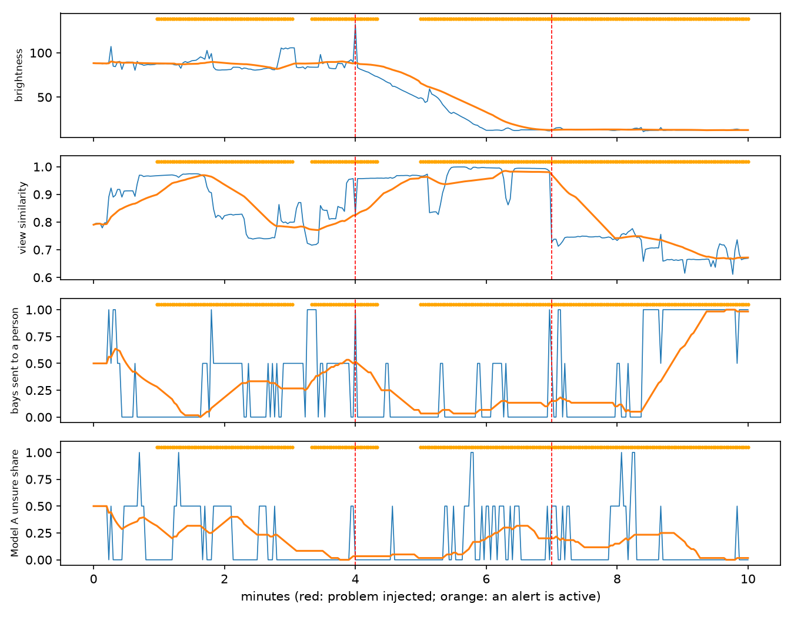

# Monitoring demonstration

Per frame the monitor records: brightness, the camera check's view similarity, whether the frame
was sent to a person, Model A's unsure share (bays with a probability between 0.2 and 0.8),
the share of bays needing review, and the time per frame. Normal ranges come from block 4
(validation). Over a rolling window of 30 frames (one minute at one frame every 2 s):

Alert conditions and the maintainer's response are in `RULES` and `ACTIONS` below.

Alerts are logged (Loguru, `alert` field) once when they start and once when they clear.

| alert | condition | what the maintainer does |
|---|---|---|
| camera_problem | over 20% of frames fail the camera check | check the lens and the camera's position; if it was moved on purpose, take a new snapshot and redraw the bay boxes |
| lighting_change | mean brightness outside normal +- 3 sd | check the street light; watch the review rate |
| many_reviews | over 30% of bays need a person | look at the evidence frames; if the scene changed for good, collect frames and re-adapt Model A |
| model_unsure | Model A unsure share over 3x normal | as above: a sign of a new kind of scene |
| slow | time per frame p95 over 500 ms | check the Mac's load; lower the frame rate |
| commands_misread | owner rejected over 30% of the last 20 proposals | read the feedback records; teach the owner the fixed form; consider changing Model C |

## Normal ranges (block 4, validation)

| brightness_mean | brightness_sd | unsure | review |
|---|---|---|---|
| 84.338 | 5.396 | 0.011 | 0.298 |

## The replayed stream: what the monitor saw

Problems injected: the street light dims from 4:00 (to 15% by 6:00); the camera is knocked at 7:00.

| time | event |
|---|---|
| 0:58 | alert: model_unsure |
| 2:16 | alert: many_reviews |
| 2:48 | cleared: many_reviews |
| 3:04 | cleared: model_unsure |
| 3:20 | alert: many_reviews |
| 4:22 | cleared: many_reviews |
| 5:00 | alert: lighting_change |
| 5:46 | alert: model_unsure |
| 8:36 | alert: camera_problem |
| 8:38 | alert: many_reviews |
| 9:08 | cleared: model_unsure |

## What this shows

- The dimming light was flagged (`lighting_change`) about a minute after it began, and Model A then became unsure (`model_unsure`).
- The knocked camera was flagged (`camera_problem`) only after about 1.5 minutes: on this night, normal frames already score 0.75-0.97 on the view check (headlights and parked cars change the scene), and the knocked view scored about 0.74, just above the cut-off set on the training night (0.725). It crossed it only when a car drove in.
- Before any problem, the monitor fired twice: while a car stood across both bays for minutes (one bay always needs a person) and while cars were manoeuvring (Model A unsure). The first is useful news for the owner; the second is a false alarm that a longer window would reduce.

