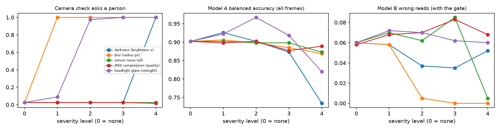

# Image robustness (increasing severity)

Stresses (4 levels each): darkness (the street light fails), blur (a dirty or fogged lens),
sensor noise (night grain), JPEG compression (a weak video link) and headlight glare (a bright
blob over the bays). Each is applied to the whole frame.

- Model A + the camera check: frames of night video 1 (a seen night, one every 4 s, moving periods
  left out). For each level: how often the camera check asks a person (graceful abstention),
  and Model A's balanced accuracy on the frames it still answers.
- Model B: 400 public plate test images under the same stresses: exact full-plate reads,
  wrong reads and coverage, with the product's confidence gate.
Command robustness (typos, missing pieces, ambiguity, off-topic, tricks) is in
outputs/commands/robustness.md.

## Model A and the camera check (the other night)

| stress | level | frames | camera check asks a person | Model A balanced acc. (answered) | Model A balanced acc. (no camera check) | parked cars missed (answered) | empty called occupied (answered) |
|---|---|---|---|---|---|---|---|
| darkness (brightness x) | 1.0 | 122 | 0.025 | 0.897 | 0.902 | 22 | 2 |
| darkness (brightness x) | 0.6 | 122 | 0.025 | 0.923 | 0.926 | 14 | 4 |
| darkness (brightness x) | 0.35 | 122 | 0.025 | 0.898 | 0.902 | 17 | 7 |
| darkness (brightness x) | 0.2 | 122 | 0.025 | 0.868 | 0.873 | 22 | 9 |
| darkness (brightness x) | 0.1 | 122 | 1.0 |  | 0.734 | 0 | 0 |
| blur (radius px) | 0.0 | 122 | 0.025 | 0.897 | 0.902 | 22 | 2 |
| blur (radius px) | 2.0 | 122 | 1.0 |  | 0.906 | 0 | 0 |
| blur (radius px) | 4.0 | 122 | 1.0 |  | 0.898 | 0 | 0 |
| blur (radius px) | 8.0 | 122 | 1.0 |  | 0.885 | 0 | 0 |
| blur (radius px) | 16.0 | 122 | 1.0 |  | 0.869 | 0 | 0 |
| sensor noise (sd) | 0.0 | 122 | 0.025 | 0.897 | 0.902 | 22 | 2 |
| sensor noise (sd) | 10.0 | 122 | 0.025 | 0.897 | 0.902 | 22 | 2 |
| sensor noise (sd) | 20.0 | 122 | 0.025 | 0.893 | 0.898 | 22 | 3 |
| sensor noise (sd) | 40.0 | 122 | 0.025 | 0.893 | 0.898 | 22 | 3 |
| sensor noise (sd) | 80.0 | 122 | 0.025 | 0.867 | 0.873 | 28 | 3 |
| JPEG compression (quality) | 95.0 | 122 | 0.025 | 0.897 | 0.902 | 22 | 2 |
| JPEG compression (quality) | 40.0 | 122 | 0.025 | 0.893 | 0.898 | 22 | 3 |
| JPEG compression (quality) | 20.0 | 122 | 0.025 | 0.897 | 0.902 | 22 | 2 |
| JPEG compression (quality) | 10.0 | 122 | 0.025 | 0.871 | 0.877 | 27 | 3 |
| JPEG compression (quality) | 5.0 | 122 | 0.016 | 0.886 | 0.889 | 26 | 1 |
| headlight glare (strength) | 0.0 | 122 | 0.025 | 0.897 | 0.902 | 22 | 2 |
| headlight glare (strength) | 0.25 | 122 | 0.09 | 0.92 | 0.922 | 15 | 2 |
| headlight glare (strength) | 0.5 | 122 | 0.975 | 0.5 | 0.967 | 0 | 0 |
| headlight glare (strength) | 0.75 | 122 | 1.0 |  | 0.918 | 0 | 0 |
| headlight glare (strength) | 1.0 | 122 | 1.0 |  | 0.82 | 0 | 0 |

## Model B (public plate test images)

| stress | level | images | exact | wrong reads | answered |
|---|---|---|---|---|---|
| darkness (brightness x) | 1.0 | 400 | 0.703 | 0.23 | 0.932 |
| darkness (brightness x) | 0.6 | 400 | 0.71 | 0.223 | 0.932 |
| darkness (brightness x) | 0.35 | 400 | 0.705 | 0.21 | 0.915 |
| darkness (brightness x) | 0.2 | 400 | 0.63 | 0.263 | 0.892 |
| darkness (brightness x) | 0.1 | 400 | 0.475 | 0.268 | 0.743 |
| blur (radius px) | 0.0 | 400 | 0.703 | 0.23 | 0.932 |
| blur (radius px) | 2.0 | 400 | 0.52 | 0.312 | 0.833 |
| blur (radius px) | 4.0 | 400 | 0.03 | 0.12 | 0.15 |
| blur (radius px) | 8.0 | 400 | 0.0 | 0.0 | 0.0 |
| blur (radius px) | 16.0 | 400 | 0.0 | 0.0 | 0.0 |
| sensor noise (sd) | 0.0 | 400 | 0.703 | 0.23 | 0.932 |
| sensor noise (sd) | 10.0 | 400 | 0.688 | 0.237 | 0.925 |
| sensor noise (sd) | 20.0 | 400 | 0.603 | 0.26 | 0.863 |
| sensor noise (sd) | 40.0 | 400 | 0.24 | 0.365 | 0.605 |
| sensor noise (sd) | 80.0 | 400 | 0.005 | 0.04 | 0.045 |
| JPEG compression (quality) | 95.0 | 400 | 0.705 | 0.225 | 0.93 |
| JPEG compression (quality) | 40.0 | 400 | 0.695 | 0.233 | 0.927 |
| JPEG compression (quality) | 20.0 | 400 | 0.672 | 0.263 | 0.935 |
| JPEG compression (quality) | 10.0 | 400 | 0.632 | 0.297 | 0.93 |
| JPEG compression (quality) | 5.0 | 400 | 0.463 | 0.352 | 0.815 |
| headlight glare (strength) | 0.0 | 400 | 0.703 | 0.23 | 0.932 |
| headlight glare (strength) | 0.25 | 400 | 0.695 | 0.233 | 0.927 |
| headlight glare (strength) | 0.5 | 400 | 0.685 | 0.242 | 0.927 |
| headlight glare (strength) | 0.75 | 400 | 0.682 | 0.24 | 0.922 |
| headlight glare (strength) | 1.0 | 400 | 0.675 | 0.237 | 0.912 |

